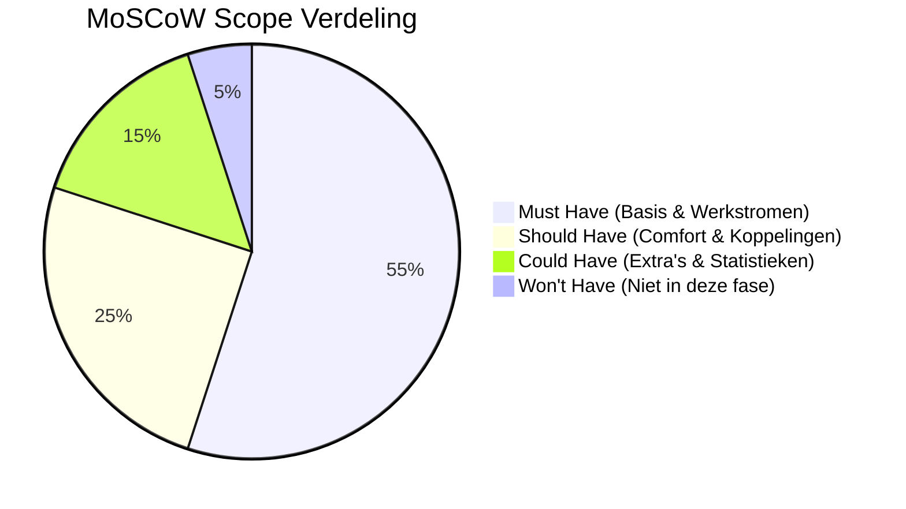
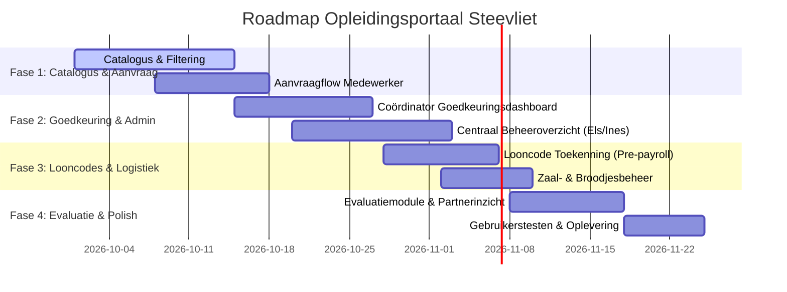

# Dossier & Strategisch Plan: Eerste Klantgesprek Steevliet vzw
**Opleidingsbeheer & Workflowoptimalisatie**  
*Projectopdracht HOGENT — Voorbereiding Eerste Klantgesprek*

---

## 1. Executive Summary & Context Steevliet vzw

### Wie is Steevliet vzw?
Steevliet vzw is een toonaangevende organisatie binnen de **Bijzondere Jeugdzorg** in Oost-Vlaanderen (o.a. campussen in Melle, Sint-Maria-Oudenhove/Zottegem en Gent). Zij bieden residentiële opvang (leefgroepen), gezinshuizen, contextbegeleiding en autonoom wonen aan kwetsbare kinderen en jongeren van 0 tot 25 jaar.

### De Organisatiecultuur & Werknemerspopulatie
Binnen Steevliet werken medewerkers met sterk uiteenlopende profielen en werkroosters:
1. **Pedagogisch personeel (opvoeders, leefgroepbegeleiders, contextbegeleiders):**
   - Werken in wisselende shiften, avonden, nachten en weekends.
   - Opleidingen vallen daardoor vaak **binnen** of juist **buiten** hun geplande werkrooster.
2. **Logistiek personeel (keuken, onderhoud, facilitair, transport):**
   - Hebben specifieke praktijkgerichte opleidingen nodig (bv. HACCP, EHBO, veiligheid).
3. **Administratief & Ondersteunend personeel (secretariaat, financiën):**
   - Volgen specifieke kantoortrainingen (IT, wetgeving, communicatie).
4. **Leidinggevenden & Coördinatoren:**
   - Moeten overzicht houden over teamcompetenties, bezetting in de leefgroepen en goedkeuringen.

> [!IMPORTANT]
> **Belangrijkste richtlijn voor de meeting:** De klant heeft **geen technische kennis**. We vermijden alle IT-vaktaal (geen termen als Blazor, WASM, REST API, EF Core, SQL of JSON). We praten uitsluitend over **tijdwinst, duidelijkheid voor medewerkers, foutloze loonverwerking en kwaliteitsborging**.

---

## 2. Huidige Situatie (AS-IS) vs. Gewenste Situatie (TO-BE)

| Processtap | Huidige Situatie (AS-IS) 🛑 | Gewenste Situatie (TO-BE) ✨ |
| :--- | :--- | :--- |
| **1. Opleidingsaanbod** | Els stelt handmatig een lijst op; medewerkers zoeken op goed geluk online of in losse documenten. Geen opdeling per functiegroep. | Eén centrale, gebruiksvriendelijke digitale catalogus, gesorteerd per functiegroep (Pedagogisch, Logistiek, Admin) en type (intern/extern). |
| **2. Aanvraag & Akkoord** | E-mail lawine: medewerker mailt coördinator -> coördinator mailt terug -> mailketting naar Els, Ines en boekhouding. Mails raken kwijt. | Met 1 klik een aanvraag indienen. De coördinator krijgt direct een melding en keurt goed met 1 klik. Automatische notificaties naar alle betrokkenen. |
| **3. Administratie & Opvolging** | Ines moet alle gegevens handmatig overtikken in een groot Excel-bestand. Foutgevoelig en tijdsintensief. | Centraal dashboard waarin alle inschrijvingen realtime zichtbaar zijn. Gedaan met losse Excel-bestanden. |
| **4. Logistiek & Zalen** | Zaalreservering en broodjes bestellen gebeuren via losse telefoontjes en mailtjes. | Direct bij het inplannen van een opleiding kan een lokaal (bv. Campus Melle) en catering (broodjes) aangeduid worden. |
| **5. Tijdregistratie & Looncodes** | **Grootste frustratie:** Ines moet bij de loonbetaling uitzoeken wie aanwezig was, of het binnen of buiten werktijd viel, en manueel looncodes invoeren in het tijdregistratiesysteem. | Het systeem koppelt automatisch de juiste situatie (binnen/buiten werktijd, overuren) aan de juiste **looncode** en levert een kant-en-klaar overzicht voor tijdregistratie. |
| **6. Evaluatie & Partners** | Evaluatieformulieren worden per mail gestuurd door Ines. Als ze al terugkomen, moet Ines ze handmatig lezen en classificeren. | Digitale mini-evaluatie (1 minuut) direct na de opleiding. Automatische kwaliteitsbeoordeling per opleidingspartner. |

---

## 3. Business Value (Wat levert dit Steevliet concreet op?)

In het gesprek met de directie en kerngebruikers (Els, Ines) focussen we op 4 grote pijlers van bedrijfswaarde:

1. **Enorme Tijdwinst (tot 70% minder administratief overtikwerk):**
   - Ines en Els hoeven niet langer handmatig Excel-bestanden bij te houden, e-mailketens door te spitten of looncodes handmatig op te zoeken.
   - De tijd die vrijkomt kan direct gaan naar de kernopdracht van Steevliet: kwalitatieve zorg voor jongeren.
2. **Foutloze Loonverwerking & Eerlijke Vergoeding:**
   - Duidelijke scheiding tussen opleiding binnen versus buiten werktijd voorkomt fouten in overuren en looncodes.
   - Verhoogt het vertrouwen en de tevredenheid bij shiftenmedewerkers.
3. **Rust en Transparantie voor Iedere Medewerker:**
   - Een begeleider ziet direct of zijn aanvraag goedgekeurd is zonder te hoeven bellen of mailen.
   - Duidelijk overzicht welke vormingen relevant zijn voor zijn of haar functie.
4. **Strategisch Kwaliteitsinzicht:**
   - Direct inzicht in betrouwbare interne en externe opleidingspartners via gestructureerde beoordelingen.
   - Geen geld meer verspillen aan externe opleidingen die slecht scoren.

---

## 4. Scope Afbakening (MoSCoW-Methode)

Om het project realistisch en succesvol op te leveren (zeker met een kleiner team), bewaken we de scope strikt:

### 🟢 MUST HAVE (Wat minimaal in de oplossing móét zitten voor oplevering)
- Digitale opleidingscatalogus met filtering op functiegroep (Pedagogisch, Logistiek, Administratief) en intern/extern.
- Aanvraagformulier voor medewerkers (inclusief vermelding 'binnen of buiten werktijd' en eventuele zaal/cateringwens).
- Goedkeuringsmodule voor coördinatoren met statusopvolging (In behandeling, Goedgekeurd, Afgewezen).
- Centraal beheeroverzicht voor Ines en Els ter vervanging van de Excel-sheet.
- Duidelijk looncode-overzicht per gevolgde opleiding (klaargezet voor Ines' tijdregistratie).
- Digitaal evaluatieformulier voor de medewerker na afronding.

### 🟡 SHOULD HAVE (Belangrijke functies, direct na de Must Haves)
- Automatische e-mailnotificaties bij statuswijzigingen (Aanvraag ingediend -> Goedgekeurd -> Herinnering evaluatie).
- Overzichtelijke zaal- en cateringlijst voor interne vormingen op de campussen.
- Eenvoudig exportoverzicht (Excel/CSV) voor de tijdregistratie en boekhouding.
- Kwaliteitsranking van externe opleidingspartners op basis van medewerkersscores.

### 🔵 COULD HAVE (Als er tijd overblijft)
- Automatische herinneringen aan medewerkers die hun evaluatie nog niet hebben ingediend.
- Uitgebreide managementrapportage over opleidingsbudgetten per afdeling.
- Uploaden van behaalde certificaten of attesten (bv. EHBO-diploma).

### 🔴 WON'T HAVE (Buiten scope voor dit project — duidelijk communiceren!)
- Geautomatiseerde bi-directionele live API-koppeling met het sociaal secretariaat of externe loonverwerkingssoftware (zoals SD Worx of Attentia) — dit vereist dure externe licenties en API-contracten. Een helder exportbestand is de afgesproken oplossing.
- Een volledig HRMS (Human Resource Management System) voor verlofaanvragen of ziekteregistratie.

---

## 5. Product Backlog & Roadmap

### Belangrijkste User Stories (Klantentaal)
1. **Als pedagogisch medewerker** wil ik een overzicht zien van opleidingen op maat van leefgroepbegeleiding, zodat ik gericht kan kiezen wat mijn vakkennis versterkt.
2. **Als medewerker** wil ik bij mijn aanvraag aanduiden of dit binnen of buiten mijn rooster valt, zodat mijn gewerkte uren correct worden verloond.
3. **Als teamcoördinator** wil ik in één oogopslag de aanvragen van mijn team zien en goedkeuren, zodat de leefgroepbezetting gewaarborgd blijft.
4. **Als Ines (Loonadministratie)** wil ik direct de juiste looncode zien bij voltooide opleidingen, zodat ik de uren zonder fouten kan overnemen in het tijdregistratiesysteem.
5. **Als Els (Opleidingsverantwoordelijke)** wil ik zien welke externe partners goed scoren bij onze mensen, zodat we enkel samenwerken met kwalitatieve opleiders.

---

## 6. Gespreksagenda voor het Eerste Klantgesprek van Morgen

### Duur: ca. 30 - 45 minuten

| Tijdstip | Onderwerp | Doel |
| :--- | :--- | :--- |
| **00 - 05 min** | **Welkom & Korte Introductie** | Positieve sfeer zetten; benadrukken dat we er zijn om te luisteren en hun dagelijkse werk vlotter te maken. |
| **05 - 15 min** | **Samen de Pijnpunten & Behoeften Overlopen** | Valideren of we hun huidige werkwijze (Excel, e-mails, tijdregistratie) goed begrepen hebben. |
| **15 - 25 min** | **Rondleiding door het Interactief Prototype** | Het visuele prototype tonen! De klant ziet direct hoe een medewerker, coördinator en Ines te werk gaan. Directe reacties en 'aha-momenten' vangen. |
| **25 - 35 min** | **Verdiepende Vragen (Scope & Details)** | De 6 kernvragen stellen over looncodes, zalen en evaluaties (zie checklist hieronder). |
| **35 - 45 min** | **Volgende Stappen & Afspraken** | Samenvatten wat we meenemen naar Sprint 1 en datum prikken voor de volgende tussentijdse demonstratie. |

---

## 7. Concrete Vragenlijst voor Steevliet (Klantinterviews)

Neem deze vragenlijst mee in het gesprek. *(Merk op: De basis looncode-toewijzing hebben we al opgelost met LC-101 binnen dienst vs LC-204 buiten dienst. We vragen dus niet "welke looncode", maar richten ons op de integratie en automatisatie)*:

1. **Over Tijdregistratie & CSV-Import (voor Ines):**
   - *"We hebben de scheiding tussen 'binnen dienst' (LC-101) en 'buiten dienst' (LC-204) al geautomatiseerd. Welk tijdregistratiesysteem gebruikt Steevliet vandaag (bv. Protime, SD Worx, AFAS)? Kan Ines hierin rechtstreeks een exportbestand (CSV/Excel) inlezen, of worden de uren nu nog veld per veld overtikt?"*
2. **Over Shiften & Weekendtoeslagen:**
   - *"Zijn er bij vormingen in het weekend of 's avonds nog specifieke extra toeslagen (zoals weekendpremie, ploegenpremie of verplaatsingsvergoeding) die automatisch gekoppeld moeten worden?"*
3. **Over de Goedkeuringsflow:**
   - *"Is goedkeuring van de teamcoördinator altijd voldoende, of is bij duurdere externe vormingen (bv. boven €500) ook een tweede handtekening van de directie vereist?"*
4. **Over Attesten & Herhalingsopleidingen (voor Els):**
   - *"Moeten certificaten met een wettelijke vervaldatum (zoals EHBO elke 3 jaar of HACCP) automatisch notificaties sturen zodat Els tijdig herhalingscursussen kan inplannen voor het team?"*
5. **Over de Zalen & Broodjes:**
   - *"We tonen nu Campus Melle en Campus St-Maria-Oudenhove. Werken jullie met vaste lokale bakkers en zijn er specifieke deadlines voor de bestelbon?"*
6. **Over Kwaliteitsreviews van Opleidingspartners:**
   - *"Els beoordeelt nu zowel de inhoudelijke relevantie voor de leefgroep als de kwaliteit van de externe lesgever (bv. Pimento vzw vs Vormingsbureau X). Zijn er specifieke accreditaties of criteria die Els hierbij extra wil opvolgen?"*

---

## 8. Tips voor Haktan (Leiderschap & Teamdynamiek)

> [!TIP]
> **Hoe je als leider straalt, zelfs met een uitgedund team:**
> - **Wees gerust:** Docenten en klanten waarderen het enorm als één iemand het voortouw neemt met een professioneel, goed gestructureerd verhaal en een werkend prototype.
> - **Begin met empathie:** Zeg bijvoorbeeld: *"We hebben jullie video grondig bestudeerd en we zagen meteen hoeveel tijd Ines en Els verliezen aan e-mails en Excel. Ons doel is om jullie die tijd terug te geven."*
> - **Laat de mock-up het werk doen:** Zodra je het interactieve prototype laat zien, is de klant geboeid. Laat hen klikken of meedenken.
> - **Schrijf actief mee:** Wanneer de klant antwoordt op je vragen over looncodes of zalen, noteer dit zichtbaar. Dit toont ultieme betrokkenheid.
